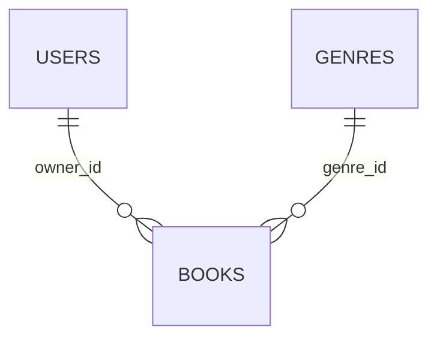

# Лабораторная работа № 5 — Supabase

Главное изменение: жанры раньше приходили из JSON-файла сайта, теперь — из настоящей базы.
Книги пока остаются в `useState` в App и исчезают после F5. Таблица books подготовлена
для следующего этапа; приложение ещё не читает и не записывает туда книги.

## Какие файлы показывать

| Файл | Что рассказывать |
| --- | --- |
| `supabase/migrations/20261103090000_initial_schema.sql` | Создаёт genres и books, задаёт обязательные поля, связи, проверки и правила доступа. |
| `supabase/seed.sql` | Добавляет семь жанров. Повторный запуск обновляет названия без создания дублей. |
| `frontend/.env.example` | Образец настроек. Настоящие значения лежат в игнорируемом `.env.local`. |
| `frontend/src/lib/supabase.ts` | Один общий клиент для обращения к базе. Ошибку настройки показывает форма. |
| `frontend/src/services/genres.ts` | Загружает id и name из genres, сортирует, проверяет ошибки и структуру ответа. |
| `frontend/src/hooks/useGenres.ts` | Как в ЛР 4: хранит загрузку, ошибку или данные; повторяет и отменяет запрос. |
| `frontend/src/components/BookForm.tsx` | Показывает жанры и кнопку «Обновить справочник». Черновик при обновлении остаётся. |

Цепочка: форма → хук → сервис → клиент Supabase → таблица genres → обратно в форму.
SDK выполняет HTTP-запрос вместо нашего прямого вызова fetch.

## Схема

| Таблица | Поля и ограничения |
| --- | --- |
| genres | id — текстовый первичный ключ, непустой без пробелов по краям; name — обязательное уникальное непустое название без пробелов по краям. |
| books | id — UUID автоматически; owner_id — обязательная ссылка на auth.users; genre_id — обязательная ссылка на genres. |
| books | title — 3–100 символов; author — непустой; status — planned/reading/finished; rating — целое 1–5 или NULL. |
| books | description и note — текст; added_at — обязательная дата; created_at — время создания автоматически. |

Удаление владельца удаляет его книги. Удаление жанра, на который ссылается книга,
запрещено. Изменение id жанра переносится в связанные книги.

RLS включён для обеих таблиц. Для anon и authenticated разрешено только чтение genres:
нужны одновременно право SELECT и разрешающая политика RLS. Запись жанров запрещена.
Для books нет клиентских прав и политик: личные записи закрыты до авторизации в следующей лабе.
Publishable key — публичный ключ приложения, он не заменяет пользователя и не обходит RLS.
Пароль базы и secret/service_role нельзя помещать во frontend.

## Настройка с нуля

1. Создать проект Supabase. В SQL Editor выполнить целиком миграцию
   `supabase/migrations/20261103090000_initial_schema.sql` один раз.
2. В новом запросе выполнить `supabase/seed.sql`. Можно повторять; личные книги не создаются.
3. Скопировать `frontend/.env.example` в `frontend/.env.local`, заполнить URL и Publishable key.
4. Из frontend выполнить `npm ci`, `npm run dev`. После изменения env перезапуск обязателен.
5. Проверить `npm run lint`, `npm run build`, `npm run preview`.

## Демонстрация и проверки

1. Открыть создание книги и Network с фильтром `genres`. Запрос идёт на домен
   проекта Supabase, путь `/rest/v1/genres`, ответ 200 с семью жанрами.
2. Заполнить название и автора, выбрать жанр, нажать «Обновить справочник».
   Введённые поля и id жанра должны остаться. Сохранить книгу и открыть редактирование.
3. Включить Offline после загрузки сайта, нажать обновление справочника:
   появится ошибка. Вернуть сеть, нажать «Повторить»: ввод сохранён.
4. Для задержки включить Slow 3G: видна загрузка; сохранение заблокировано.
   Уход со страницы отменяет запрос через AbortController.
5. В учебной базе через SQL Editor изменить только name жанра, нажать обновление
   в форме: имя обновится, выбранный id и другие поля останутся. Вернуть названия seed.sql.
6. Пока books пустая, можно временно очистить genres в SQL Editor и обновить форму:
   отдельное сообщение об отсутствии жанров, сохранение недоступно. Сразу восстановить seed.sql.
7. Проверить ограничения и права скриптом `supabase/verify.sql` в SQL Editor.
   Он проверяет ограничения в откатываемых блоках и не оставляет тестовые записи.

Коротко для защиты: «Я подготовил схему базы и разграничил доступ. Сайт читает
общий справочник жанров из Supabase, а личная таблица книг пока закрыта.
Загрузка, ошибки и повтор работают через прежний хук; обновление справочника не стирает форму».
